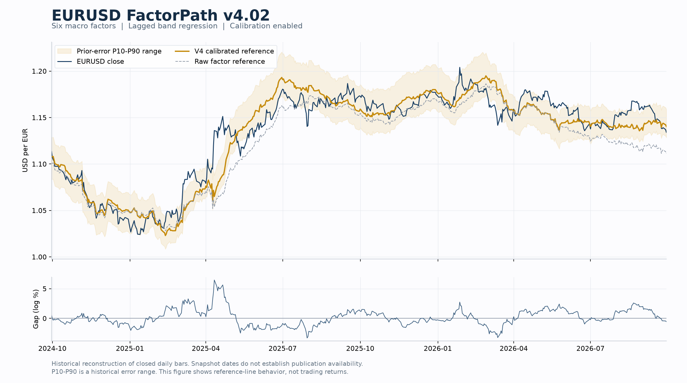

# EURUSD FactorPath v4

**EURUSD 宏观因子条件参考线：数学方法、因子选择与效果图。** 对应 v4.02 的默认频段回归与历史残差校准设置，方法记录日期为 2026-09-30。

**English:** Methodology and illustration for a six-factor EURUSD conditional reference. The method combines causal EMA decomposition, lagged rolling regressions, prior-residual calibration and empirical error ranges.

图中深蓝线为 EURUSD 收盘价，金线为校准后的 v4 参考线，灰虚线为原始因子线，浅金区域为此前误差的 P10–P90。下图为价格相对校准参考线的对数偏离。它展示历史条件参考线的形状与偏离，不是收益曲线。

完整公式、因子定义、计算步骤及解释边界见 **[制作方法](docs/METHOD.md)**。这份仓库仅发布文档与图片。

## 六个因子

| 因子 | 口径 | 经济含义 |
|---|---|---|
| 2Y 利率互换利差 | 欧元减美元 | 政策利率路径的相对定价 |
| 10Y 国债利差 | 德国减美国 | 长期主权收益率差异 |
| 意德 10Y 利差 | 意大利减德国 | 欧元区外围风险与金融分化 |
| 2Y–3M 曲线差 | 两币种 2Y–3M 斜率之差 | 较近期限结构的相对变化 |
| 10Y–3M 曲线差 | 两币种 10Y–3M 斜率之差 | 较长期限结构的相对变化 |
| 法德 10Y 利差 | 法国减德国 | 法国相对德国的主权风险 |

因子以 EURUSD 为对象构造，共同进入多元回归，不预设权重或系数符号。经济解释是选择依据，不能代替每个因子的独立预测验证。

## 核心构造

将因子分解为因果 EMA 趋势项与残差项，用此前窗口分别估计低频水平敏感度和高频变化敏感度：

$$
\hat y_t^{\mathrm{raw}}=a_{L,t}+\beta_{L,t}^{\mathsf T}\bar x_t+\beta_{H,t}^{\mathsf T}(x_t-\bar x_t),\qquad y_t=100\ln P_t.
$$

当前价格不参加当前系数估计。再用此前实际生成的原始误差均值校准水平，并用此前显示误差的分位数构造经验范围。

| 默认参数 | D1 日线 | W1 周线 |
|---|---:|---:|
| 回归窗口 | 504 根 | 104 根 |
| EMA 跨度 | 21 根 | 4 根 |
| 历史残差校准窗口 | 63 根 | 13 根 |
| 经验误差范围窗口 | 252 根 | 52 根 |

## 如何理解效果

这条线回答“当前因子状态在历史关系下对应怎样的价格参考”，且校准后含有历史价格信息。因子快照日期不等于发布时间，因此滞后拟合也不能直接称为真实可交易预测。

历史比较显示，EURUSD 上频段回归的原始水平误差在八组比较中均低于线性版本；循环移位对照表明改善主要来自去噪，因子信息贡献大致持平。跨货币对推广的联合验收未通过，法德因子的旧线性增量比较也未通过全部门槛。验证方法与解释边界见制作方法。

误差带是历史经验范围，偏离是描述量。现有证据未证明偏离会均值回归，也未证明交易盈利。
